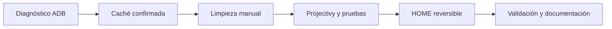

<a href="README.md">Read in English</a> · Android TV 10 · ADB sin root · Caso real

# Xiaomi TV P1: optimización documentada

**Un caso real, reversible y medido** en un **Xiaomi Mi TV P1 de 55 pulgadas** con **Android TV 10 / API 29, compilación QTG3.200305.006.5135**, el 20 de octubre de 2026. No es una receta universal para eliminar aplicaciones: el comportamiento depende del firmware y sus dependencias.

## Qué hicimos diferente y de quién son las herramientas

La inspiración inicial fue la idea de utilizar agentes de programación con IA para personalizar televisores. **Este proyecto no es una copia de otro repositorio sobre Claude, ni un lanzador nuevo, ni un firmware propio.** Es un caso documentado y validado en un televisor específico.

- **Herramientas de terceros:** Android Debug Bridge (ADB), los ajustes oficiales de Android TV y [Projectivy Launcher](https://github.com/spocky/miproja1).
- **Aportación propia del caso:** metodología por etapas con autorizaciones, mediciones antes/después, identificación y limpieza de una caché anómala de 7,093 GiB, integración comprobada del lanzador, validaciones funcionales e instrucciones de recuperación.
- **Resultados que también publicamos:** el error reproducible del salvapantallas y la decisión de **no** desactivar otros siete paquetes sin pruebas suficientes de beneficio y seguridad.
- **Lo que no afirmamos:** haber inventado Projectivy, un nuevo método universal de optimización, una mejora generalizada de CPU o una calibración profesional del panel.

El estilo de presentación toma como **referencia visual**, y nada más, [Harness² de Google Research](https://github.com/google-research/harness2); no se reutiliza su código ni sus recursos gráficos. Consulta [qué aporta este caso práctico](docs/que-aportamos.md).

## Qué se consiguió

| Resultado | Qué se comprobó |
|---|---|
| **+7,093 GiB libres** | Limpieza **manual** de la caché excepcionalmente grande de Google Play Store; la ocupación pasó del 87 % al 24 % |
| **Projectivy 4.72 como HOME** | Netflix, Prime Video, Disney+, YouTube, Play Store, Ajustes, Xbox HDMI3, Chromecast y suspensión/reanudación pasaron las pruebas indicadas |
| **+63,54 MiB de RAM disponible** | Comparación controlada de Projectivy con Google Launcher activo/desactivado, sin cambiar de arranque |
| **CPU 18,71 % → 18,38 %** | En esa comparación no se demostró una mejora relevante de CPU |
| **Google Launcher reversible** | Se desactivó **solo para el usuario 0**; no se eliminó el APK original ni se modificó firmware |

Después de instalar Projectivy había **123 paquetes**; se dejó desactivado un solo paquete: `com.google.android.tvlauncher`. **PatchWall y los componentes compartidos se conservaron**.

## Metodología

Los datos son mediciones específicas, no promesas de rendimiento ni una calibración profesional. Lee las [mediciones](docs/measurements.md), el [procedimiento](docs/procedure.md) y la [compatibilidad](docs/compatibility.md).

## Antes de tocar tu televisión

- Usa ADB únicamente en tu red local de confianza y autoriza tu ordenador desde la pantalla del televisor.
- No desinstales el lanzador de fábrica. Comprueba primero que Projectivy gestiona HOME y que dispones de una [recuperación](docs/recovery.md) viable.
- No desactives paquetes por su nombre sin comprobar dependencias; una limpieza en bloque puede romper entradas, notificaciones o el salvapantallas.
- La caché de Play Store se borró mediante **Ajustes → Aplicaciones → Google Play Store → Borrar caché**; **no** «Borrar datos» ni `pm clear`.
- Los scripts incluidos son de diagnóstico de solo lectura. Sus resultados quedan en tu equipo; no publiques registros sin revisarlos.

## Incidencia conocida

Al iniciar el salvapantallas, `com.google.android.tvrecommendations` intentó abrir `com.google.android.tvlauncher/.BootHelperEmptyActivity`, correspondiente al lanzador desactivado. Se reprodujo con tres proveedores de salvapantallas y **no se encontró una solución segura confirmada**. Se restauraron los ajustes anteriores; consulta [incidencias](docs/known-issues.md).

## Índice

[Qué aportamos](docs/que-aportamos.md) · [Pasos documentados](docs/procedure.md) · [Mediciones](docs/measurements.md) · [Compatibilidad](docs/compatibility.md) · [Imagen y sonido](docs/picture-audio.md) · [Recuperación](docs/recovery.md) · [Privacidad](docs/privacy.md) · [Auditoría ADB](scripts/diagnose-readonly.ps1)

## Autoría

Pruebas y proyecto: [@hamurabiperez](https://github.com/hamurabiperez). Apoyo en análisis y automatización con IA. **Proyecto independiente**, no afiliado a Xiaomi, Google ni Projectivy. Los textos, gráficos originales y script de diagnóstico de este repositorio se distribuyen bajo [licencia MIT](LICENSE). No incluye derechos sobre software ni marcas de terceros.
