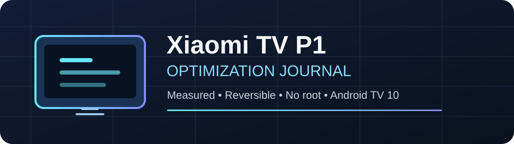
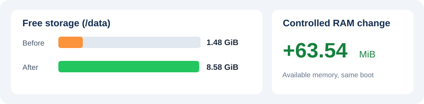

  

  
  
  
  
  
  

<strong>Measure first. Change one thing at a time. Keep a rollback path.</strong>

> [!IMPORTANT]
> **Independent case study, not a universal debloat guide.** These observations come from **one Xiaomi Mi TV P1 55-inch TV** running **Android TV 10 (API 29), firmware build QTG3.200305.006.5135**, tested on October 20, 2026. Results and package dependencies may differ by firmware. This is not affiliated with Xiaomi, Google, or Projectivy.

A documented, hands-on journey from an advertising-heavy Android TV home screen to a **Projectivy Launcher 4.72** setup—without root or modifying the system partition. It includes measurement methodology, what worked, what did not, and a recovery procedure.

## What this project contributes — and what it does not

This project was inspired by the broader idea of using AI coding agents to customize Smart TVs. **It is not a fork of a Claude-based TV modification project, a new launcher, or a replacement firmware.** It documents a tested, human-approved workflow on one specific TV.

- **Existing tools:** Android Debug Bridge (ADB), built-in Android TV settings, and [Projectivy Launcher](https://github.com/spocky/miproja1) were created by others.
- **Our contribution:** an evidence-based intervention with baseline measurements, a confirmed 7.093 GiB Play Store cache anomaly, controlled launcher comparison, step-by-step validations, explicit stop conditions, and reversible recovery instructions.
- **An important negative result:** disabling the stock launcher exposed a reproducible screensaver/recommendations-service error; seven other candidate packages were *not* disabled because the evidence did not justify the risk.
- **Not claimed:** a universal speedup, a novel debloating method, new firmware, a new launcher, or a professional color calibration.

The presentation takes **visual-documentation inspiration only** from [Google Research's Harness² repository](https://github.com/google-research/harness2). No Harness² code or artwork is incorporated. See [what is original in this case study](docs/whats-different.md).

## Results at a glance

| Observation | Evidence | Interpretation |
|---|---|---|
| Play Store cache cleared using TV settings | Free `/data` increased by **7.093 GiB** (from ~1.48 to ~8.58 GiB); occupied fell from **87% to 24%** | A device-specific cache incident, **not** an expected gain on every Android TV |
| Replaced stock HOME with Projectivy 4.72 | HOME, apps, HDMI3 Xbox, Chromecast and resume passed local checks | Launcher changed successfully on this firmware |
| Google Launcher disabled for user 0 only | Same-boot, same Projectivy-screen comparison measured **+63.54 MiB** `MemAvailable` | Some memory became available; **not** evidence of a sustained CPU improvement |
| CPU in the same controlled test | Median **18.71% → 18.38%** | Difference too small to claim a meaningful reduction |
| Stock Google Launcher APK | **Retained** in the system image and reversible | No uninstall or root required |

The final observed CPU/RAM readings depend on the conditions and are **not guaranteed performance gains**. See [measurement methodology](docs/measurements.md).

## What changed?

```mermaid
flowchart LR
    A[Read-only ADB audit] --> B[Confirm abnormal cache]
    B --> C[Clear Play Store cache from TV settings]
    C --> D[Reduce stock HOME previews]
    D --> E[Install and validate Projectivy]
    E --> F[Configure Projectivy as HOME]
    F --> G[Disable old launcher for user 0]
    G --> H[Verify apps, HDMI, cast and resume]
    H --> I[Document known issues and recovery]
```

Only **one** system package was left disabled for user 0: `com.google.android.tvlauncher`. **PatchWall and shared components were deliberately kept.** The inventory contained 123 installed packages after Projectivy installation.

## Contents

- **[Guía en español](README.es.md)** — Complete Spanish overview
- **[What this study adds](docs/whats-different.md)** — Scope, attribution, and differences from general AI-TV customization
- **[Device and test matrix](docs/compatibility.md)** — Tested setup vs. untested configurations
- **[Methodology and results](docs/measurements.md)** — Reproducibility and limitations
- **[Configuration timeline](docs/procedure.md)** — What we actually did, in order
- **[Known issues](docs/known-issues.md)** — Screensaver crash, remote and outstanding tests
- **[Picture and audio](docs/picture-audio.md)** — Settings chosen and why HDR changes were reverted
- **[Recovery](docs/recovery.md)** — Restore stock HOME, carefully
- **[Privacy and publication](docs/privacy.md)** — Why original ADB logs are *not* included
- **[Read-only audit script](scripts/diagnose-readonly.ps1)** — Optional diagnostic helper for Windows (static review only; execution not yet tested)

## Who this is for

Owners researching **Xiaomi Mi TV P1**, **Android TV debloat**, **ADB diagnostics**, **Projectivy Launcher**, or a **no-root Android TV setup**. The documented results are device-specific; adapt cautiously rather than copying commands.

## Safe starting point

1. Check that your exact firmware and available apps match the [compatibility notes](docs/compatibility.md).
2. Enable ADB debugging **only on a trusted local network**; authorize your own computer on the TV. Do not expose ADB port 5555 to the Internet.
3. Collect a **read-only** baseline before making changes. The provided script does not change device settings or package states; it saves local diagnostics, which may contain personal information.
4. Configure and test Projectivy manually. **Do not immediately disable the stock launcher.** First read the recovery guide and validate HOME plus required inputs.
5. Make changes deliberately, one at a time, with a tested way to reverse them.

> [!WARNING]
> **Do not blindly copy package-disable commands.** Disabling a launcher can break HOME navigation and linked components. A factory reset is disruptive and is not a safe substitute for a verified rollback path. The [recovery guide](docs/recovery.md) is intended for this particular setup and uses manual confirmation.

## Known unresolved issue

When the screensaver starts, `com.google.android.tvrecommendations` may try to launch `com.google.android.tvlauncher/.BootHelperEmptyActivity`, which is unavailable while stock HOME is disabled. Multiple screensaver alternatives reproduced the error. **No fix was verified** without changing the accepted configuration. See [known issues](docs/known-issues.md).

## What's next

Real Xbox gameplay, antenna reception (no antenna cable at test time), Prime Video/Disney+ content-specific A/V sync, Dolby Vision and HDR10+ playback, HDR over HDMI3, and controlled 2160p playback tests remain unverified. This project is a report of what was observed, not a claim of universal compatibility.

## Project credit and licensing

Case study and device testing: [@hamurabiperez](https://github.com/hamurabiperez), supported by AI-assisted analysis and tooling. Projectivy Launcher is an independent project: [official repository](https://github.com/spocky/miproja1). Android TV and brand names belong to their respective owners.

The original documentation, illustrations and read-only helper script in this repository are available under the [MIT License](LICENSE). This license does not apply to third-party projects, logos or trademarks.
